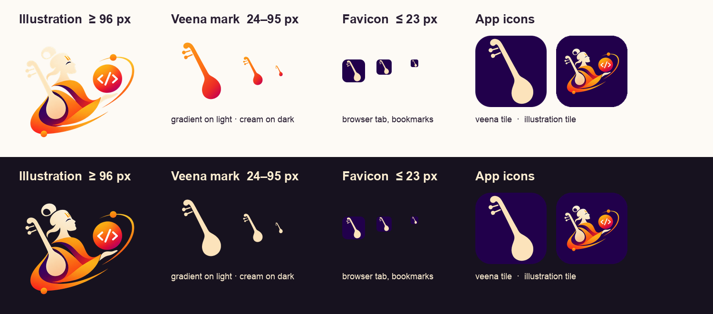
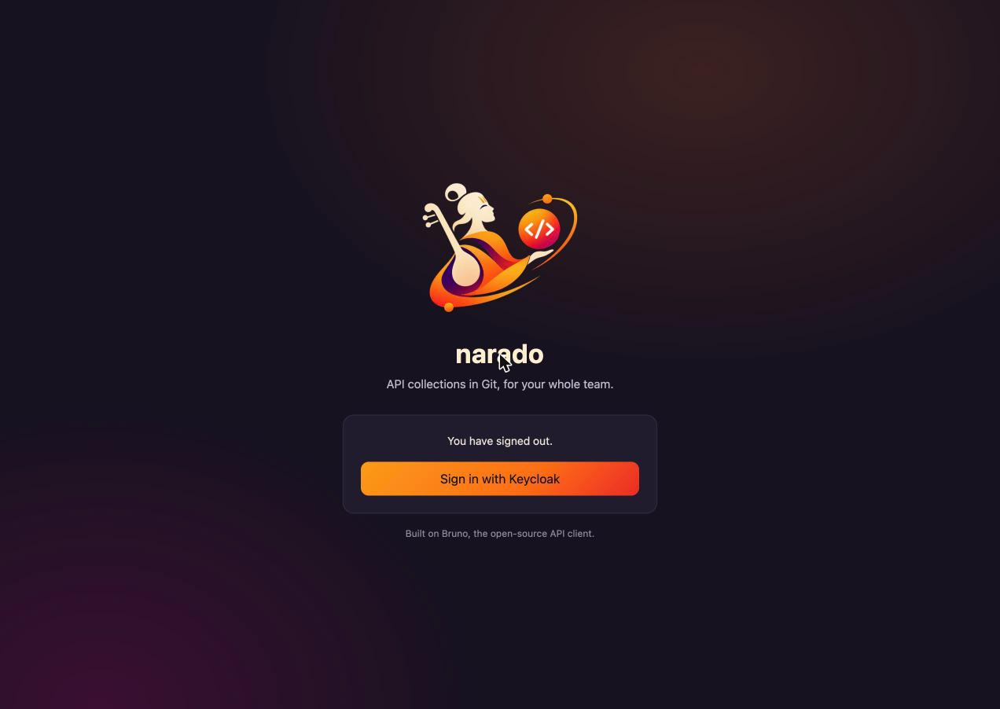
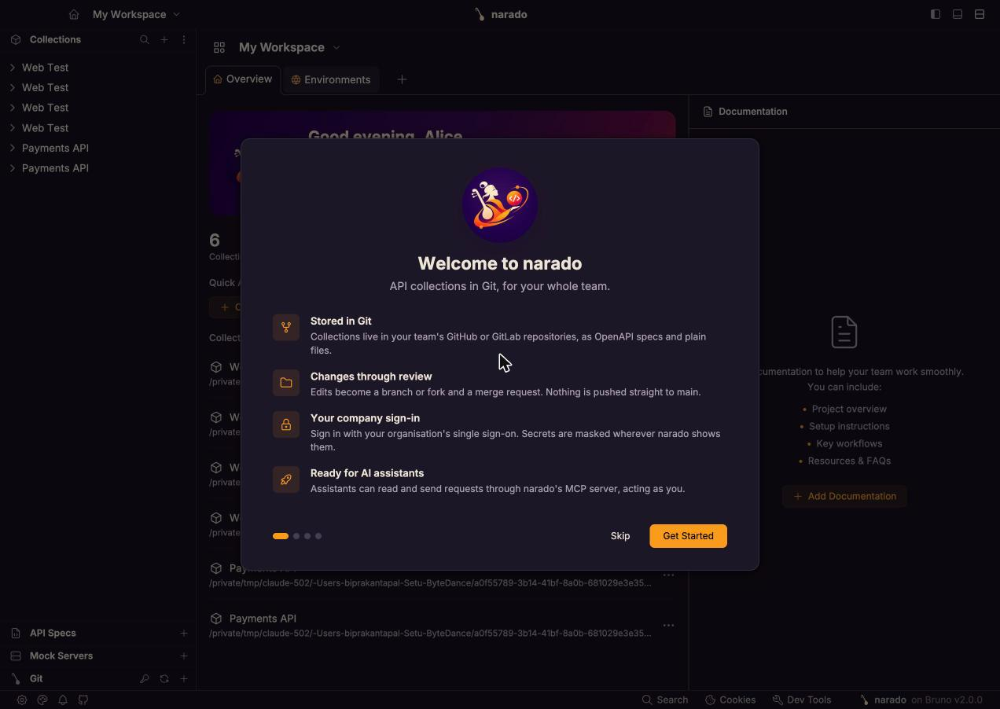
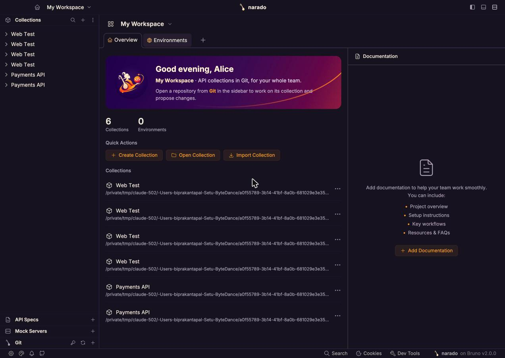
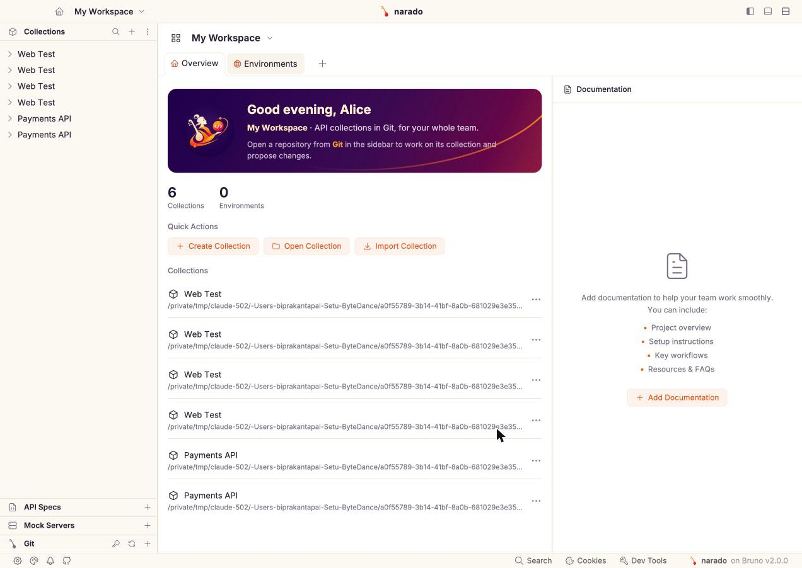
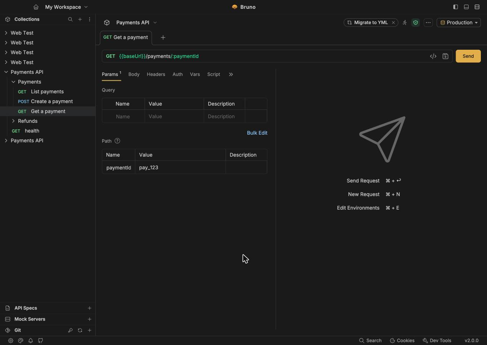
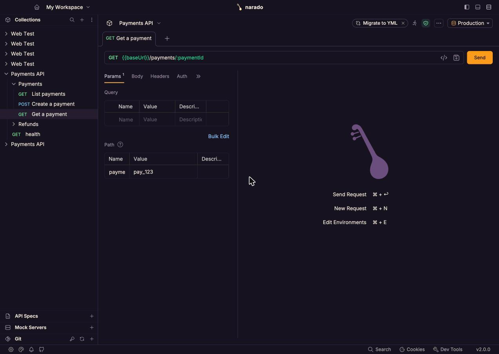
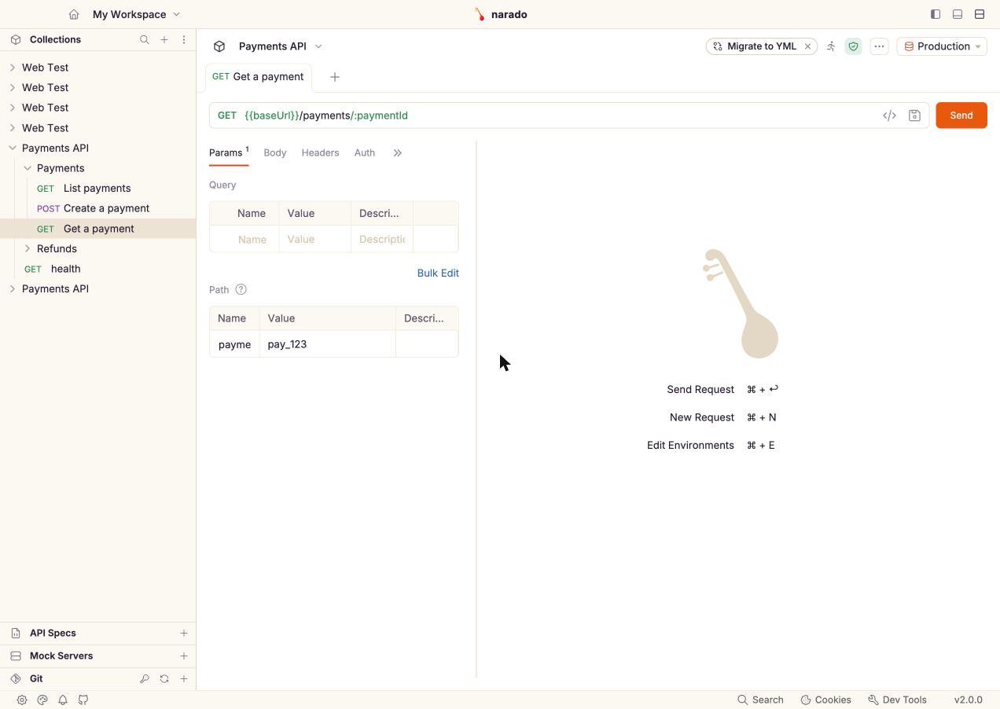

# narado branding guide

narado is named after Narada, the travelling sage and messenger who carries word between worlds, playing his veena. narado carries requests between people and APIs.

## Logo

The logo is the illustration in [`icons/narado-illustration-source.png`](icons/narado-illustration-source.png): the sage in a saffron robe, holding a veena, with an orb showing `</>` in an orbit around him.

| Asset | File | Use at |
|---|---|---|
| **Illustration** | `icons/narado-illustration*.png` (trimmed, square; 128, 256, 512 px) | 96 px and larger: sign-in, about, empty states, README, social cards |
| **Veena mark** | `icons/narado-veena.svg` (gradient), `narado-veena-cream.svg`, `narado-veena-plum.svg` | 24 to 95 px: title bar, headers, inline with the name |
| **Favicon tile** | `icons/narado-favicon.svg`, `favicon.ico`, `favicon-*.png` | browser tabs, bookmarks, home-screen and PWA icons |
| **Illustration tile** | `icons/app-icon-*.png` | app stores and large app icons, where the full story fits |

The **veena mark** is traced from the artwork's own veena as a single path, so it is the same instrument: curled scroll head, two round pegs, one long neck, pear-shaped body. Don't redraw it, add strings or gourds, or rotate it.

### Wordmark

Write the name in lower case: **narado**. It is set in Space Grotesk, weight 700, next to the veena mark, with a gap of one third of the mark's height.

### Using the logo

- **Backgrounds.** The illustration's figure and veena are cream, so it needs a dark background (night indigo `#21004B` or the dark surface `#17121F`). On light backgrounds use the illustration tile instead; cream on cream is only 1.2:1.
- **Veena mark colour.** Gradient on light backgrounds, cream `#FCE3BB` on dark ones, plum `#650748` when only one colour is possible (stamps, embossing, monochrome print).
- **Clear space.** At least half the mark's width on every side.
- **Quiet places.** In empty states the veena is drawn in the theme's muted surface colour (`NaradoVeena`), not the gradient, so it doesn't compete with the Send button.
- **Minimum size.** Veena mark 24 px; below that use the favicon tile, whose indigo square keeps the shape readable at 16 px.
- **Don't** stretch, recolour outside this palette, add effects (shadows, glows, outlines), place the illustration on busy photos, or crop the sage.

## Type

- **Space Grotesk** (weights 600 and 700) is narado's display face: the wordmark, the sign-in page's heading, and narado's own headings (the home screen greeting and empty states). Use it sparingly, for short text only.
- **Inter** is the interface face, as in Bruno, for everything else.
- Both are bundled (`@fontsource`), so nothing is fetched from Google at run time. Space Grotesk is under the SIL Open Font Licence; its licence file sits beside the font in `packages/bruno-app/public/narado/`.

## Colour

Taken from the artwork. Hex values sampled from the source image.

| Name | Hex | Role |
|---|---|---|
| **Saffron** | `#FB9B1A` | The brand colour: primary actions in dark mode, highlights |
| **Flame** | `#FD6E15` | Gradient middle; secondary accent |
| **Vermilion** | `#EC2B26` | Gradient; errors only when paired with an icon or text |
| **Crimson** | `#CE0A47` | Gradient end |
| **Plum** | `#650748` | Deep accent, single-colour mark, shadows in the art |
| **Night indigo** | `#21004B` | Icon tiles, hero backgrounds |
| **Cream** | `#FCE3BB` | The sage and veena; marks on dark |
| **Ivory** | `#FDEED2` | Light text on plum and indigo |

**Brand gradient:** saffron `#FB9B1A` → flame `#FD6E15` (50%) → vermilion `#EC2B26` (85%) → crimson `#CE0A47`, running from top-left to bottom-right. Use it for the mark and for large brand moments, not for buttons or text.

### In the interface

The interface themes are generated from Bruno's by [`make-themes.mjs`](make-themes.mjs), so every Bruno screen picks the brand up. Re-run `node branding/make-themes.mjs` after merging upstream Bruno.

| Token | narado Light | narado Dark |
|---|---|---|
| Primary (buttons, active tab) | `#E8590C` flame, deepened | `#FB9B1A` saffron |
| Primary text (links, labels) | `#C2410C` | `#FDB55A` |
| Background | `#FFFFFF`, surfaces warm cream `#FCF8F2` to `#E4D8C6` | `#17121F`, surfaces plum-tinted `#1D1726` to `#5D5468` |
| Text | `#2A1F33` (plum-black) | `#EDE4D8` (warm cream) |
| Neutral greys | tinted warm (light) or toward plum (dark) | |

Contrast, checked against WCAG 2.1:

| Pair | Ratio | |
|---|---|---|
| Primary text `#C2410C` on white | 5.18 | AA for body text |
| White on light primary `#E8590C` | 3.58 | AA for bold button labels and large text only |
| Text `#2A1F33` on white | 15.65 | AAA |
| Saffron `#FB9B1A` on dark `#17121F` | 8.58 | AAA |
| Text `#EDE4D8` on dark `#17121F` | 14.61 | AAA |
| Cream veena on night indigo | 14.44 | |
| Saffron on white | 2.14 | Never use for text or thin lines on light backgrounds |

Bruno's other themes (Nord, Dracula, Catppuccin and the rest) stay available in Preferences. narado Light and narado Dark are the defaults in the web build; browsers that were on Bruno's default Light or Dark are moved to narado's once.

## Screens

| Sign-in | Welcome | Overview (dark) | Overview (light) |
|---|---|---|---|
|  |  |  |  |

- **Sign-in** (`packages/bruno-web-server/src/narado/pages.js`): illustration, wordmark and a "Sign in with …" button (`NARADO_OIDC_PROVIDER_NAME`), which turns into the loader while the provider opens. Sign-out and sign-in errors land here too. `NARADO_OIDC_AUTO_REDIRECT=1` skips it.
- **Loading**: [`loader-dark.gif`](loader-dark.gif) shows the animation, in which rings ripple out as the veena is plucked. It is `icons/narado-loader-{light,dark}.svg`, pure CSS, and holds still for people who turn on reduced motion. Used on sign-in, the start-up screen and request loading.
- **Welcome dialog** (first run): the illustration and narado's own four points, since Bruno's "offline, on your disk" claims don't apply to a server.
- **Overview**: a night-indigo banner with the illustration, the orbit from the artwork, a greeting by first name and the workspace.
- **Elsewhere**: "narado on Bruno v…" in the status bar, the veena in the empty response pane, and the illustration on the home screen when no tab is open.

## Screenshots

| Before (Bruno) | narado Dark | narado Light |
|---|---|---|
|  |  |  |

## Where the brand appears in the code

- `packages/bruno-app/public/narado/`: the icons the app serves.
- `packages/bruno-app/src/components/Narado/Brand.js`: `NaradoMark` (the veena mark, gradient or cream by mode) and `NaradoVeena` (the veena in the current text colour).
- `packages/bruno-app/src/components/ResponsePane/Placeholder/`: the veena replaces Bruno's paper plane in the empty response pane.
- `packages/bruno-app/src/components/AppTitleBar/`: title bar mark and wordmark.
- `packages/bruno-app/src/web-bridge.js`: page title, favicon, one-time theme migration.
- `packages/bruno-app/src/themes/narado/`: generated themes.

All of it applies only to the web build (`window.isBrunoWeb`). The Electron app keeps Bruno's name, logo and themes, which keeps merges from upstream simple.

## Product name

`packages/bruno-app/src/utils/common/product.js` has `productName()`, `isNarado()` and the repository links. Product text in the web build says narado; the **Bruno file format** and import/export type keep the name Bruno (".bru, Bruno's native format", "Bruno Collection (ZIP)"), because narado really does read and write that format. Support links point to narado's repository for issues and code, and keep Bruno's docs and community with a "built on Bruno" link.

## Not done yet

- The provider's own sign-in form (Keycloak in development) is not branded; narado's page comes before it.
- The app's JavaScript has to download before the start-up screen can show, so a slow first load is briefly blank.

The veena is narado's mark, not an icon for a feature: keep it off sections and buttons such as Git, which use ordinary icons.
