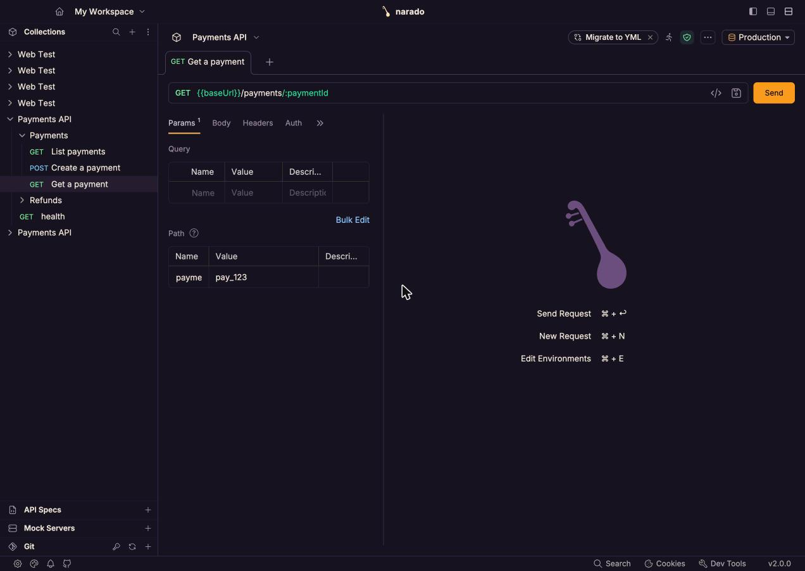

<p align="center">
  
</p>

<h1 align="center">narado</h1>

<p align="center"><strong>API collections in Git, for your whole team.</strong><br>
A self-hosted, browser-based API client built on <a href="https://github.com/usebruno/bruno">Bruno</a>.</p>

---

narado is named after Narada, the travelling sage who carries word between worlds. It carries requests between your team and your APIs.

Your collections live in your own GitHub or GitLab repositories, stored as OpenAPI specs. Everyone works in the browser against one narado server. Changes go through branches and merge requests, the same way code does.



## What it does

- **Bruno in the browser.** Bruno's interface for building and sending requests, with environments, scripts and tests, running on a server you control. HTTP requests are tested in narado; Bruno's other request types have not been checked yet.
- **Git is the storage.** Open a repository from GitHub or GitLab and narado clones it on the server. Edits stay local until you save them.
- **Changes through review.** Saving on the default branch asks for a new branch, or a fork when you can only read the repo, and opens a pull or merge request. You can update from main and resolve conflicts in the interface.
- **OpenAPI as the source of truth.** Requests are stored in the repo's OpenAPI spec, with client-only data (values, scripts, tests, allowed hosts, and GraphQL, gRPC and WebSocket requests) in a `.narado/` folder beside it. `.narado/config.nar` names the spec, so it can have any file name; without it, narado looks for `openapi.yaml` or `openapi.json`. Edits in the interface go back into the spec, keeping its formatting.
- **Company sign-in.** Any OpenID Connect provider: Okta, Microsoft Entra ID, Google Workspace, Keycloak and others. You can restrict sign-in to your email domains.
- **Secrets stay in your secrets store.** Environments hold references such as `secret://vault/payments/staging#api_key`; the server swaps in values only when it sends, and the browser never sees them. Vault can decide per person; other stores follow access rules by repo and person.
- **Requests can't reach what they shouldn't.** The server refuses loopback, cloud metadata and private networks, after DNS and on every redirect, and each repo's requests only go to hosts listed on its default branch, so new hosts go through review.
- **Secrets bound to collections.** When an environment on a repository's default branch references a secret, anyone who can read that repository may use it; narado reads it with its own service credentials. Admins add other access in the admin pages.
- **narado desktop and the `narado` command.** The desktop app (macOS, Windows, Linux) sends from your own computer, so `localhost` and your network work, and keeps working offline. The `narado` command signs in with SSO and runs local tools with `.env` values that are `secret://` references.
- **Setup and admin pages.** A one-time setup link in the server's log, then `/admin`: sign-in, admins, GitHub and GitLab apps that narado creates for you, secrets stores, access rules and everyone's signed-in computers.
- **MCP server for AI assistants.** Assistants such as Claude Code can list, read and send requests and propose changes through `/mcp`, using personal tokens that act as the person who made them. Sends only reach hosts the workspace names, and secrets are masked.

## Quick start (development)

Requires Node.js 24 (see `.nvmrc`), Git, and the repo's dependencies (`npm run setup` from the root).

```bash
NARADO_GITHUB_TOKEN=$(gh auth token) node packages/bruno-web-server/src/server.js
```

```bash
npm run dev:web
```

Open http://localhost:3000. Without sign-in configured, narado is a single-user tool that uses that one Git token, and only listens on `127.0.0.1`. With sign-in, each person connects their own GitHub or GitLab account through narado's GitHub App or GitLab application instead. To try sign-in locally, start the Keycloak realm in [`packages/bruno-web-server/dev/keycloak`](packages/bruno-web-server/dev/keycloak) and follow its README.

Configuration, Git hosts, sign-in, the MCP server and known limits are documented in [`packages/bruno-web-server/README.md`](packages/bruno-web-server/README.md). To run it for a team with Docker and HTTPS, see [`packages/bruno-web-server/deploy`](packages/bruno-web-server/deploy/README.md).

## How it fits together

| Part | Where |
|---|---|
| Server: a front process for sign-in and routing, and one sandboxed Bruno process per person whose IPC is relayed to the browser over a WebSocket | [`packages/bruno-web-server`](packages/bruno-web-server) |
| Git workspaces, GitHub and GitLab, OpenAPI storage, MCP, sign-in | [`packages/bruno-web-server/src/narado`](packages/bruno-web-server/src/narado) |
| Browser bridge and narado's interface additions | [`packages/bruno-app/src/web-bridge.js`](packages/bruno-app/src/web-bridge.js), [`packages/bruno-app/src/components/Narado`](packages/bruno-app/src/components/Narado) |
| narado desktop: narado's worker in Electron's main process, and its client for the team's server | [`packages/bruno-web-server/src/desktop.js`](packages/bruno-web-server/src/desktop.js), [`src/narado/desktop-front.js`](packages/bruno-web-server/src/narado/desktop-front.js) |
| Admin and setup pages, settings | [`src/narado/admin.js`](packages/bruno-web-server/src/narado/admin.js), [`src/narado/settings.js`](packages/bruno-web-server/src/narado/settings.js) |
| The `narado` command | [`packages/bruno-web-server/bin/narado.js`](packages/bruno-web-server/bin/narado.js), [`src/narado/cli.js`](packages/bruno-web-server/src/narado/cli.js) |
| Logo, colours, icons and themes | [`branding`](branding) |

Bruno's own desktop app (`packages/bruno-electron` without `NARADO_DESKTOP=1`) is kept as Bruno, so upstream changes merge easily.

## Status

narado is in active development and not production-ready yet.

| | |
|---|---|
| Done | Bruno in the browser · Git workspaces on GitHub and GitLab · branches, forks and merge requests · OpenAPI storage · MCP server · OpenID Connect sign-in · a separate, sandboxed Bruno process per person · secrets from Vault, AWS, Google Cloud and Azure, bound to collections through their environments · request safety (block list and per-repo host allowlists) · each person's own Git account (GitHub App, GitLab OAuth) · an API catalogue across repositories, including code repositories carrying their API, cloned with only their collection folders · one-click Sync of a personal copy into your workspace · setup and admin pages · narado desktop phases D1–D3 (runs from source: sign-in through the server, local request rules, offline) · the `narado` command · OAuth 2 sign-ins to APIs through narado's own callback · branding |
| Next | Desktop D4 (installers, signing, auto-update) and D5 (a local MCP server, tests on all three systems); one container or OS user per person's worker. |

GitHub and GitLab have both been tried end to end against GitHub.com and GitLab.com: connecting an account, opening a repository (light clones included), editing, and opening a pull or merge request as the person.

## Working on narado

Welcome! A few things that will save you time.

**Where things live**

- This repository, branch **`web`** (the default branch). `main` is Bruno's code; Bruno itself is the `upstream` remote (`https://github.com/usebruno/bruno.git`) for merging its changes.
- Designs, decisions and progress notes are in the design repository, [`biprakanta/api-client-design`](https://github.com/biprakanta/api-client-design): `docs/design.md` for the server and `docs/desktop.md` for the desktop app. Read those before larger changes; they say what was decided and why.
- Brand rules (names, colours, type, where the veena may appear) are in [`branding/README.md`](branding/README.md). The veena is brand-only: it never stands in for a feature icon.

**Set up**

```bash
nvm use
```

```bash
npm run setup
```

That's Node.js 24 (from `.nvmrc`) and the dependencies for all packages. If Electron's binary download stalls (it comes from GitHub), install it through a mirror:

```bash
ELECTRON_MIRROR=https://npmmirror.com/mirrors/electron/ node node_modules/electron/install.js
```

**Run it**

- **Single user, no sign-in:** see Quick start above. Runs on `127.0.0.1` with your own GitHub token.
- **With sign-in and secrets, like a team:** start the Keycloak realm in [`packages/bruno-web-server/dev/keycloak`](packages/bruno-web-server/dev/keycloak) (test users `alice` and `bob`) and, for secrets, the Vault in [`dev/vault`](packages/bruno-web-server/dev/vault). Then start the server with the `NARADO_OIDC_*` settings from the Keycloak README. On first start, open the setup link the server prints to name yourself an admin.
- **The desktop app,** from source:
  ```bash
  NARADO_SERVER_URL=http://localhost:3000 npm run dev:narado-desktop
  ```
- **The command:**
  ```bash
  node packages/bruno-web-server/bin/narado.js --help
  ```

Keep your own credentials (GitHub App or GitLab application secrets, tokens) in a file outside the repository, such as `~/.narado-dev.env` (mode 600), and load it with `set -a; . ~/.narado-dev.env; set +a`. Nothing secret goes into commits.

**Test**

```bash
cd packages/bruno-web-server && npm test
```

```bash
cd packages/bruno-app && npx jest src/components/Narado src/components/RequestTabs
```

The server tests take about 15 seconds and need no network. For changes you can see, also try them in the running app: the tests use fakes, and some bugs only show up for real.

**Making changes**

- Branch from `web`, and open a pull request against `web`. Don't force-push shared branches.
- Keep upstream Bruno code changes small and marked with a `narado` comment, so merges from Bruno stay easy. narado's own code lives under `packages/bruno-web-server/src/narado` and `packages/bruno-app/src/components/Narado`.
- Write commit messages, comments and interface text in plain, short sentences that say what happens and why.
- Security-sensitive areas, where changes need a second look: `src/narado/requests/` (what requests may reach), `src/narado/secrets/` (who reads which secret), `src/narado/devices.js` and `auth.js` (sign-in), and `src/narado/git-accounts.js` (people's Git tokens).

## Built on Bruno

narado is a fork of [Bruno](https://github.com/usebruno/bruno), the open-source, Git-friendly API client by Anoop M D, Anusree P S and contributors. Bruno does the hard part; narado adds the server, Git hosting, sign-in and MCP around it. Bruno's own readme is kept in [README.bruno.md](README.bruno.md).

## License

MIT, as Bruno is. See [license.md](license.md), which keeps Bruno's copyright notice.
